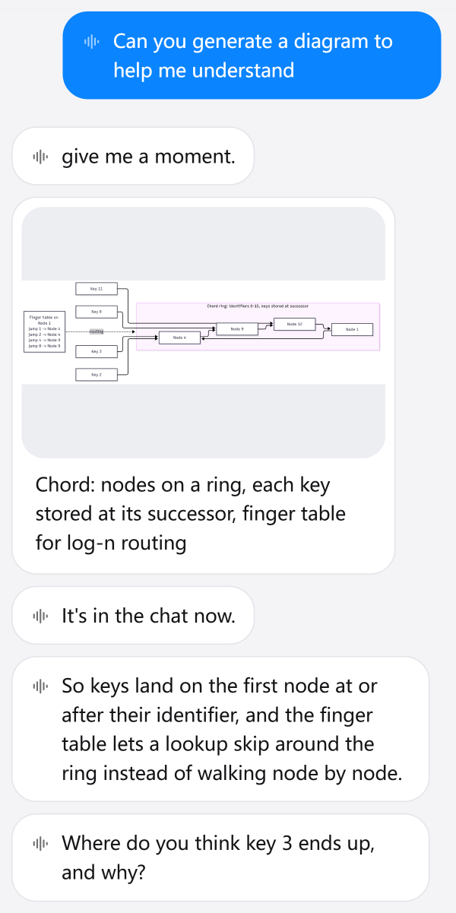
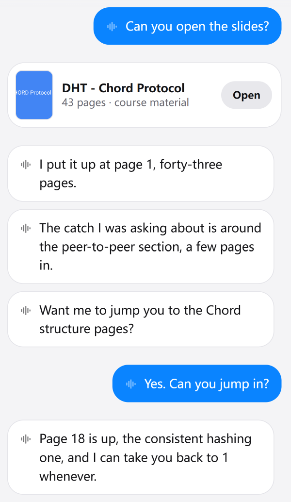
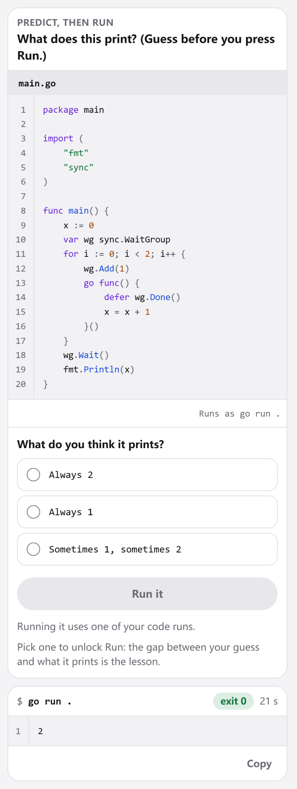
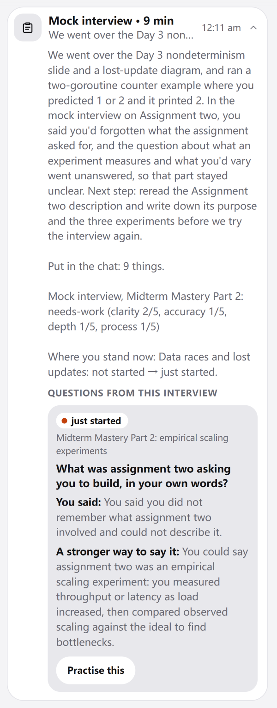
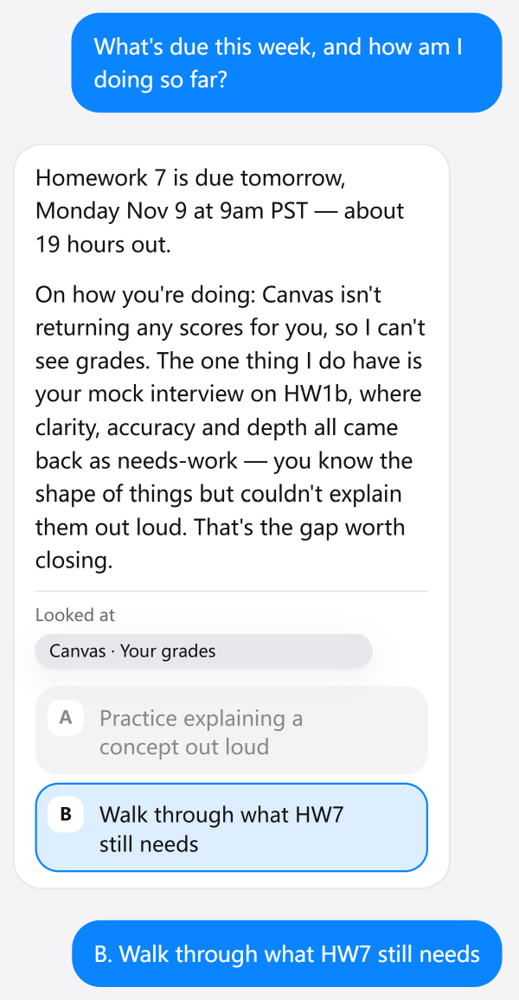
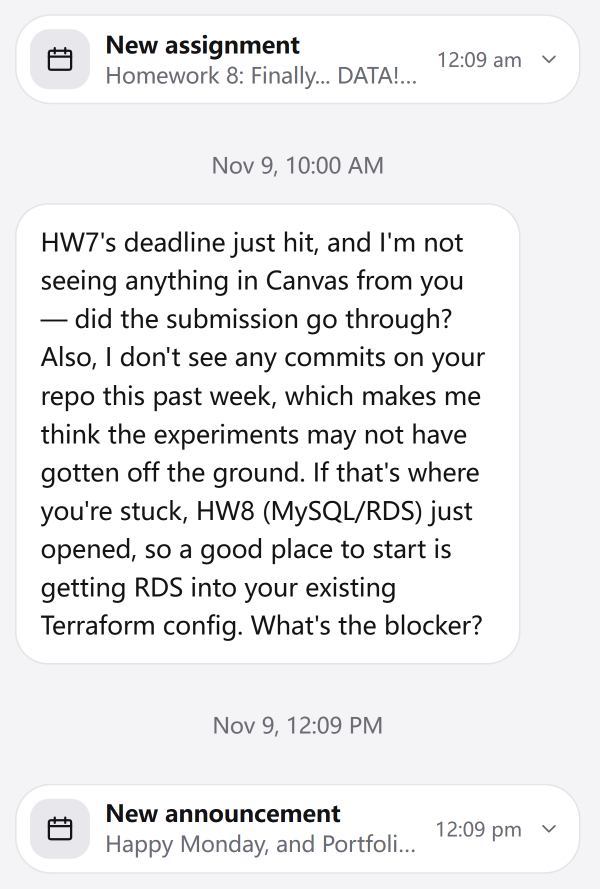
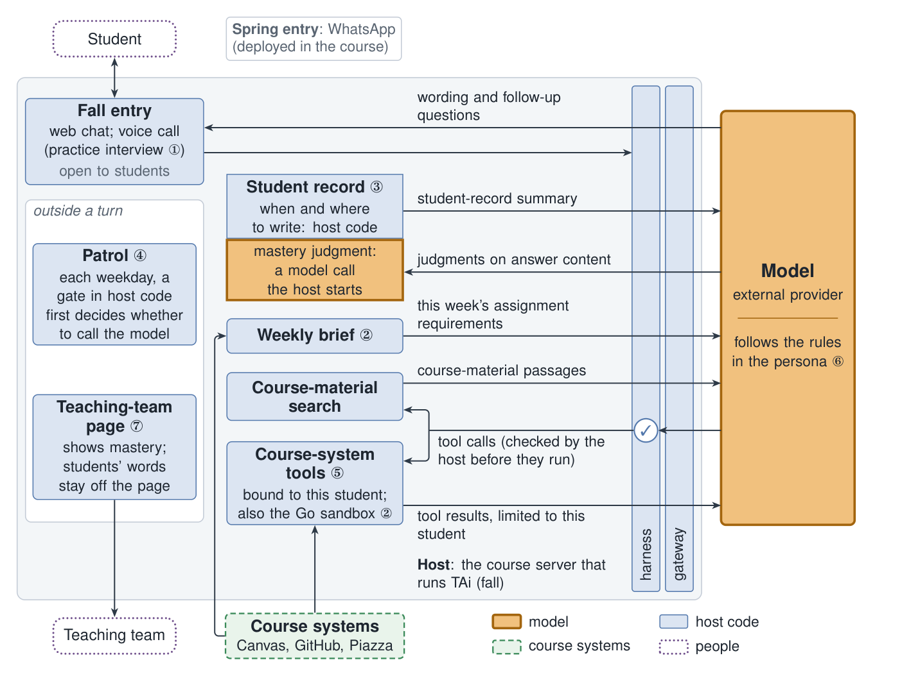
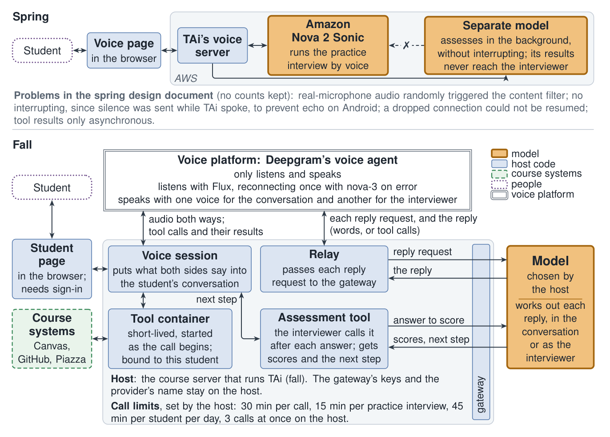
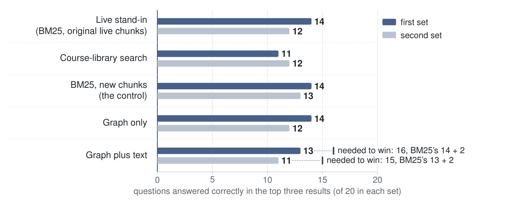
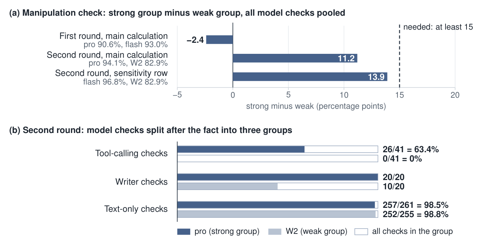

<div align="center">

# TAi

**An agentic AI teaching assistant for a graduate distributed systems course**

[](LICENSE)
[](https://github.com/YuzhengShi/tai-deploy/releases/tag/thesis-2026-12)
[](https://www.youtube.com/watch?v=XpgPXcv_oyQ)
[](package.json)
[](tsconfig.json)
[](https://github.com/gavrielc/nanoclaw)

[Demo](#demo) · [What TAi does](#what-tai-does) · [Architecture](#architecture) · [Running TAi](#running-tai) · [Documentation](docs/README.md) · [Evaluation](#evaluation) · [Citation](#citation)

</div>

TAi is the AI teaching assistant (AI TA) of CS6650 *Building Scalable Distributed Systems* at Northeastern University in Vancouver. It is an AI agent: a large language model that calls tools on the student's behalf. The MS thesis *TAi: An Agentic Teaching Assistant for a Graduate Distributed Systems Course* (Yuzheng Shi, Northeastern University, December 2026) describes this system.

Most of a CS6650 grade, 80%, comes from oral interviews:

- **Mock interviews, every week.** A TA runs and grades them, with three students at a time. Each student walks through the code they wrote that week, makes it run, and fields questions on the concepts.
- **Two Mastery interviews**, at midterm and at the end of term.

So the most useful thing an AI TA can do here is give students a place to rehearse out loud. From TAi's web page, a student can call TAi and get a one-to-one **practice interview** on their own code and the current week. TAi rates each answer without saying so and uses the ratings to choose its next question. When the call ends, a review card appears in the chat. Practice is feedback, not assessment: TAs still give every grade.

> [!NOTE]
> **The tag [`thesis-2026-12`](https://github.com/YuzhengShi/tai-deploy/releases/tag/thesis-2026-12) is the version the thesis describes.** Work on `main` may continue after it.

## Demo

<div align="center">

[](https://www.youtube.com/watch?v=XpgPXcv_oyQ)

*TAi: Mock Interview AI TA for CS6650* (YouTube)

</div>

<table>
  <tr>
    <td align="center" width="33%"><br><sub><b>A diagram requested by voice</b></sub></td>
    <td align="center" width="33%"><br><sub><b>Slides opened by voice</b></sub></td>
    <td align="center" width="33%"><br><sub><b>Guess the output, then run it</b></sub></td>
  </tr>
  <tr>
    <td align="center"><br><sub><b>The review card at the end of a practice interview</b></sub></td>
    <td align="center"><br><sub><b>A Canvas lookup for this student</b></sub></td>
    <td align="center"><br><sub><b>A patrol note once a deadline passed</b></sub></td>
  </tr>
</table>

<sub>Screenshots of the live student page from the author's own chats with TAi (November 2026). The page header, which shows the account, is cropped out. The low interview scores are for the author's own answers.</sub>

## What TAi does

From the way CS6650 teaches and grades, the thesis derives seven jobs for an AI TA (its Table 3.1), and TAi has one part for each:

| # | In the course | What the AI TA has to do | TAi's part |
|:-:|---|---|---|
| 1 | A graded mock interview every week | Let students rehearse explaining their code and the concepts aloud | **Practice interview.** TAi acts as the interviewer in a voice call on the student page, one short question at a time. Each answer gets a score from 1 to 5 for technical accuracy, verbal clarity, problem-solving process and depth of reasoning. The scores steer the follow-ups, and a review card closes the call. [VOICE](docs/VOICE.md) |
| 2 | In the interview, students show and run the code they wrote that week | Know the student's code, submissions and posts for the week; execute the code | **Weekly brief and Go sandbox.** The brief pulls together the week's requirements, the student's Canvas status and feedback, their GitHub commits and their Piazza posts. The sandbox runs Go in a throwaway container: no keys, no network during the run, and the source mounted read-only. [WEEKLY_BRIEF](docs/WEEKLY_BRIEF.md), [GO_SANDBOX](docs/GO_SANDBOX.md) |
| 3 | A fresh topic and a fresh interview each week of the term | Keep track of how far each student has got | **Student record and student state.** The record tracks mastery concept by concept (confidence, stability, scope) together with misconceptions, and host code updates it after every answer. The state notes the repository, the last stopping point and one concrete problem. [STUDENT_MODEL](docs/STUDENT_MODEL.md), [STUDENT_STATE](docs/STUDENT_STATE.md) |
| 4 | Homework is due Monday at 9 a.m., ahead of the interview | Nudge students before deadlines and interviews | **Patrol.** Runs on weekdays at 9:00 Pacific. Host code, the gate, checks first whether today needs the model at all. [PATROL](docs/PATROL.md) |
| 5 | Course data is split over Canvas, GitHub and Piazza | Fetch this student's information and nothing about anyone else | **Course-system tools bound to the student.** On Canvas it sees just this student's grades, submissions and due dates, along with whatever course content students may view. GitHub covers only this student's account and the course organization. Piazza comes through a single account limited to public posts. Students sign in with Google, and the sign-in must match the roster. [PORTAL](docs/PORTAL.md), [SECURITY](docs/SECURITY.md) |
| 6 | Students must explain their own work, and the fall syllabus allows AI tools only as support | Guide; never do the work | **Persona rules.** Socratic questions, a single question per turn, and never an assignment answer. A strategy table matches the approach to the student's mastery. [persona](groups/global/CLAUDE.md), [strategies](groups/global/TEACHING_STRATEGIES.md) |
| 7 | TAs do the grading, in the mock interviews | Give the teaching team a view of the class that leaves out what students said in practice | **Teaching-team page.** Read only: a mastery heat map, the students who need attention, and the patrol's last week. No transcripts and no student words. [TEAM_VIEW](docs/TEAM_VIEW.md) |

Students have had parts 1 to 6 since fall 2026. The teaching-team page is live too, but only the admin account can open it.

<details>
<summary><b>More of the student page</b></summary>

- **Documents.** Short-lived containers with no network access render PDFs and Office files. During a conversation, TAi can bring up a page or point to a spot on it, and the professor's decks live in a course library. [DOCUMENTS](docs/DOCUMENTS.md), [COURSE_DOCS](docs/COURSE_DOCS.md), [VIEWER](docs/VIEWER.md), [VIEWER_VOICE](docs/VIEWER_VOICE.md)
- **Cards.** Run cards, charts, step-by-step sequences and prediction cards. [CHAT_OBJECTS](docs/CHAT_OBJECTS.md), [RUN_CARDS](docs/RUN_CARDS.md), [CARDS](docs/CARDS.md), [PREDICT](docs/PREDICT.md)
- **Pictures.** TAi reads the text of a screenshot. With `TAI_VISION=1` it can also look at charts. [OCR](docs/OCR.md), [VISION](docs/VISION.md)
- **Notifications** that arrive while the page is closed, by Web Push or e-mail. [NOTIFICATIONS](docs/NOTIFICATIONS.md)
- **Deadlines** in Pacific time, plus the student's own time zone. [COURSE_TIME](docs/COURSE_TIME.md)
- **Progress.** A status line while TAi works, then a list of what it consulted. [PROGRESS](docs/PROGRESS.md)
- **Highlighted code** in replies. [HIGHLIGHT](docs/HIGHLIGHT.md)
- **Course-material search.** BM25 by default. The rebuilt LeanRAG graph is present but disabled unless switched on. [LEANRAG](docs/LEANRAG.md)

</details>

## Architecture

TAi forks [NanoClaw](https://github.com/gavrielc/nanoclaw), a framework that gives every agent conversation its own container. Since fall 2026 it has run on a server that belongs to the course, called the *host*:

<div align="center">

<br><sub>The model's inputs and outputs during one turn of a fall conversation, a figure from the thesis. The circled numbers refer to the seven parts above.</sub>
</div>

**The orchestrator** (`src/`) is written in Node.js and TypeScript. It serves the student page and runs the message loop, scheduled tasks and the patrol, the host's two writers (student record and student state), the voice hub and relay, the Go sandbox runner and the teaching-team page.

**Each student's conversation** runs in a container of its own. The container carries that student's token and the harness, the software that drives the model and its tools. The harness has been [pi](https://www.npmjs.com/package/@earendil-works/pi-coding-agent) since November 2026, with Claude Code still available.

**Every tool call passes a guard first.** The guard is code inside the student's container, attached to the harness. It strips credentials from the shell environment and blocks:

- commands that use the network, and anything aimed at private or internal addresses;
- sensitive files, and very large writes;
- GitHub lookups that reach past the student's account or the course's org;
- record writes that bump several concepts at once.

**All model traffic goes through a gateway** ([LiteLLM](https://github.com/BerriAI/litellm)) that exposes one alias per model, so moving to another provider means editing configuration.

**Throwaway containers do three more jobs:**

- a *tool container* serves the tools of a voice call, with the same access rules as the student's container;
- a *sandbox container* executes the student's Go code;
- *conversion containers* render PDF and Office files.

<div align="center">

<br><sub>Practice-interview calls, a figure from the thesis: spring on Amazon Nova 2 Sonic (AWS); fall on Deepgram's voice agent plus TAi's relay and gateway.</sub>
</div>

**Voice calls.** In the fall calls, [Deepgram](https://deepgram.com/)'s voice agent handles only speech in and speech out. Everything else happens on the host: replies, tool calls and scoring. TAi's relay hands each reply request to the gateway, which keeps the provider's keys and identity away from Deepgram and the browser. The host enforces these limits:

- a call lasts at most 30 minutes, and a practice interview 15;
- a student gets 45 minutes a day;
- the host takes 3 calls at a time.

|  | Spring 2026 | Fall 2026 |
|---|---|---|
| Runs on | AWS | The course's own server |
| Students reach it through | WhatsApp | A web page with Google sign-in and voice calls built in |
| Model | Claude on AWS Bedrock | Behind the gateway: Cerebras (qwen, gpt-oss), then DeepSeek, and now the Kimi API |
| Harness | Claude Code (Claude Agent SDK) | pi, with Claude Code available |
| Voice | Amazon Nova 2 Sonic | Deepgram's voice agent with TAi's relay |
| Course-material search | The LeanRAG graph, with AWS embeddings | BM25, with the rebuilt graph switched off |

## Running TAi

TAi was made for a single course and a single server, and the scripts in [`deploy/cs6650/`](deploy/cs6650/) assume that server. To run it the same way elsewhere, a course needs the following (after thesis Section 5.4):

- a Linux machine with Docker;
- a paid model-provider account, used through the gateway;
- a voice-platform account, which charges per minute;
- access to the course systems:
  - **Canvas:** a token with read access to the class, which the code narrows to one student at a time;
  - **GitHub:** the students' accounts plus the course organization;
  - **Piazza:** an account that can only see public posts;
- a roster pairing each student with a Canvas user and a GitHub account, plus a Google OAuth client for sign-in;
- two decisions, taken beforehand: whether course materials may go to external models, and which outside services may receive what students say or write.

**Development.** The agent image is built on Node.js 22. On newer Node versions, `better-sqlite3` may have no prebuilt binary.

```bash
npm ci
npm run build              # compile TypeScript into dist/
npm test                   # run the Vitest suite
./container/build.sh       # build the agent image
node portal/qa/dev_server.mjs   # the real student page against a pretend TAi, on 127.0.0.1:8787
```

The teaching-team page with a synthetic class of twelve: `node portal/qa/dev_server.mjs --port=8850 --out=<dir>`, then sign in as `dev:ada@example.com` ([TEAM_VIEW](docs/TEAM_VIEW.md)).

**Settings.**

- [docs/SETTINGS.md](docs/SETTINGS.md) lists every setting this fork introduces.
- [docs/PORTAL.md](docs/PORTAL.md) covers the student page, and [docs/VOICE.md](docs/VOICE.md) the calls.
- Per-student folders (`groups/<student>/`), the database (`store/`), `data/` and `logs/` exist only on the host, and git ignores them.
- `deploy/cs6650/make_course_reference.py` builds `groups/global/COURSE_REFERENCE.md` on the host from the course's published pages.

**On the course's host.**

- `deploy/cs6650/tai_credentials.sh` prompts for each key without echoing it.
- `deploy/cs6650/tai_live.sh` runs the deployment from the operator's computer over SSH, with the target given by `TAI_LIVE_HOST`. It has `deploy`, `status`, `check`, `set KEY=VALUE`, `model`, `voice`, `sandbox build`, `doc build`, `users`, `backup` and more; the script's header documents each one.

## Repository layout

```
src/              orchestrator: channels, container runner, IPC, scheduler, patrol and gate, the host's writers,
                  student page server (portal/), voice (voice/), Go sandbox runner (sandbox/), chat objects, documents
container/        agent image: agent-runner (harness, MCP tools, guard) and scripts (Canvas, GitHub, Piazza, ...)
portal/           the student page (plain HTML, CSS and JavaScript) and its QA tools
groups/           the persona and the student-record templates (per-student folders stay on the host)
leanrag/          course-material search: the BM25 stand-in and the rebuilt graph (off by default)
deploy/cs6650/    operator scripts for the course's host; the sandbox and document-renderer images; the local voice service
eval/             evaluation harnesses and results, including the weak-model experiment
docs/             design documents (index: docs/README.md)
voice/, terraform/, systemd/
                  spring 2026: the Nova Sonic voice server and the AWS deployment
memory-bank/      spring 2026 working notes of the AI coding sessions
skills-engine/, .claude/skills/, scripts/
                  NanoClaw's skills system and helper scripts (from upstream), plus a few spring scripts
```

## Documentation

The [documentation index](docs/README.md) groups the design documents by topic. Most of them say what was requested, what was built, what was measured and what was left unchecked.

## Evaluation

The thesis reports these checks. Each one used the author's own calls and account or synthetic students; none touched student data.

| What | Where | Main result |
|---|---|---|
| Fall evaluation and the move from Claude Code to pi | [eval/RESULTS.md](eval/RESULTS.md) | All 86 guard checks came out as designed under pi. pi's first model request is 55.6 KB, against 139 KB for Claude Code. On a real model, with 4 runs per scenario, pi passed 46/56 and 32/36 checks where Claude Code passed 42/56 and 30/36. |
| Course-material retrieval: the rebuilt LeanRAG graph versus BM25 | [docs/LEANRAG.md](docs/LEANRAG.md), [eval/leanrag/](eval/leanrag/) | No win for the graph on either set of 20 questions: 13 answered against BM25's 14, then 11 against 13. BM25 remains the default. |
| Weak-model experiment: a far weaker model behind every model call | [eval/weak-model/](eval/weak-model/) | Both rounds inconclusive by criteria fixed before the runs. In round 2, a local 4B model never once called a tool and invented deadlines and grades. |
| Local voice: speech recognition and synthesis on the host versus the hosted services | [docs/LOCAL_VOICE.md](docs/LOCAL_VOICE.md), [docs/VOICE_SELFBUILT.md](docs/VOICE_SELFBUILT.md), [eval/voice-local/](eval/voice-local/) | Local recognition caught 222 of 274 course terms (81.0%), hosted recognition 237 (86.5%). In one listener's blind ratings, naturalness was 2.0 for the local voice and 4.0 for the hosted one. |

<table>
  <tr>
    <td width="50%"></td>
    <td width="50%"></td>
  </tr>
  <tr>
    <td align="center"><sub>Course-material retrieval on two sets of 20 questions</sub></td>
    <td align="center"><sub>The weak-model experiment's manipulation check and model checks</sub></td>
  </tr>
</table>

## Limitations

Section 5.5 of the thesis lists the limitations in full. The main ones:

- **Narrow evidence.** All of it comes from a single course and contains no student data. Fall usage is not reported.
- **Two protections depend on the model following its persona, not on code:** staying faithful to what the tools returned, and withholding assignment answers.
- **The Go sandbox uses Docker's default runtime, runc,** so an escape through a kernel bug is still possible. gVisor is not in use, and the planned independent security review of the sandbox was never completed.
- **One admin right grants both** the class-wide view and access to students' own words.
- **What students say leaves the host in three places:** the model provider (currently the Kimi API), the voice platform, and, if image viewing is enabled, the provider of the image model.

## Privacy

- **This repository holds no student data.** The screenshots come from the author's own account, and the tests and evaluation records use synthetic students and stand-in course systems.
- **The history was rewritten before this version went public.** A person's name, internal host details and files that should never have been public were taken out of every commit. Author dates, messages and the commit count are otherwise unchanged. [docs/COMMIT_MAP.md](docs/COMMIT_MAP.md) translates the commit ids that older documents mention.

## Citation

If you use TAi or refer to it, please cite the thesis. GitHub's "Cite this repository" button reads [`CITATION.cff`](CITATION.cff).

```bibtex
@mastersthesis{shi2026tai,
  author  = {Yuzheng Shi},
  title   = {{TAi}: An Agentic Teaching Assistant for a Graduate Distributed Systems Course},
  school  = {Northeastern University, Khoury College of Computer Sciences},
  address = {Vancouver, British Columbia},
  year    = {2026},
  month   = dec,
  type    = {Master's thesis},
  note    = {Code: \url{https://github.com/YuzhengShi/tai-deploy}, tag thesis-2026-12}
}
```

## Acknowledgments

- TAi builds on [NanoClaw](https://github.com/gavrielc/nanoclaw) and keeps its MIT license.
- Dr. Yvonne Coady, the course's instructor, supervised the work. The CS6650 teaching team supported it during the terms it ran.
- AI coding assistants were used throughout development. Of the fork's 113 commits between 2026-02-23 and 2026-11-06, 106 name an AI co-author. That is a count of attributions, not of who wrote which line.

## License

[MIT](LICENSE). The license file keeps NanoClaw's copyright notice and adds a 2026 copyright line for the fork's additions by Yuzheng Shi.
